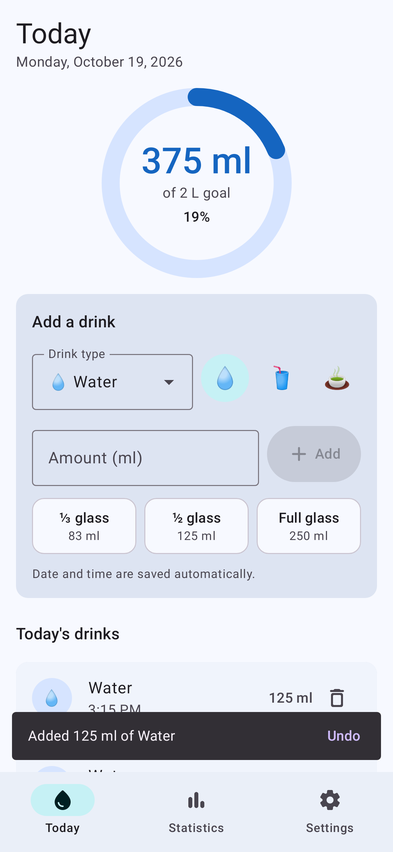
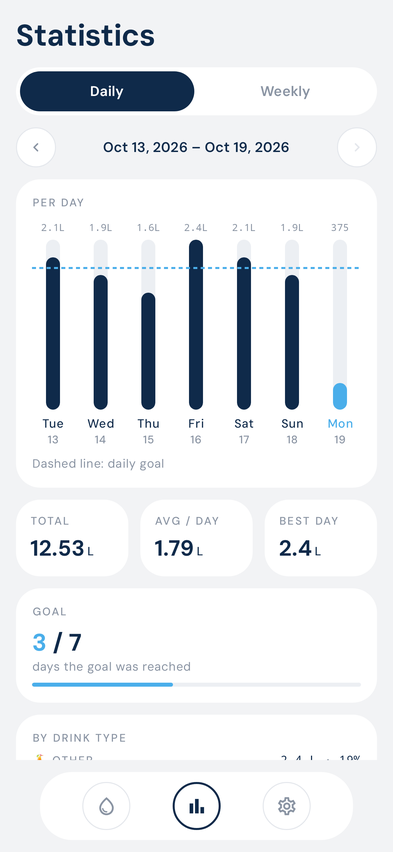
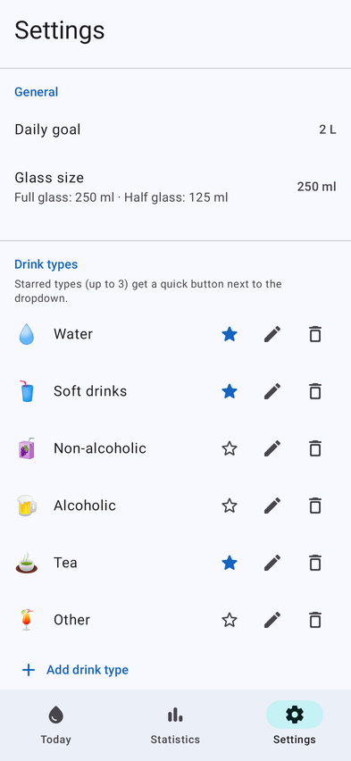
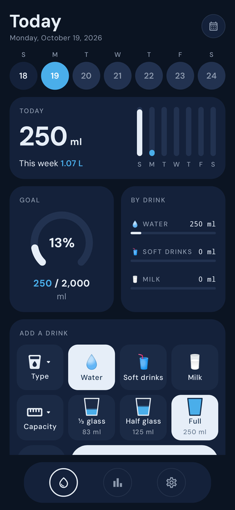

# Water Tracker

A simple Android app for keeping track of how much you drink each day.

<p>
  
  
  
  
</p>

## Features

- **Today** – this week as a row of days (dark blue = goal reached, light blue = today), today's
  total in large type with the week as thin bars, a goal gauge and today's amount per drink.
  Below 1000 ml amounts are shown in millilitres (`750 ml`); from 1000 ml on in litres with
  decimals (`1.25 L`).
- **Add a drink** – three rows of tiles:
  - **Type ▾** (every drink type) and one-tap **Water**, **Soft drinks**, **Milk**
  - **Capacity ▾** (100 ml … 1 L or a custom amount) and **⅓ glass**, **Half glass**, **Full**
  - **Date & time** (defaults to *Now*; one dialog picks both the day and the time, to log
    something you forgot) and **Add**
  - each entry can be deleted, and a snackbar lets you undo
- **Drink types** – Water, Soft drinks, Non-alcoholic, Alcoholic, Tea, Milk and Other to start with.
  In Settings you can rename them, change their icon, add new ones, remove them, and star the
  (up to 3) favorites that get a quick button.
- **Statistics** – daily (7 days per page) and weekly (8 weeks per page) bar charts with your
  daily goal as a dashed line, total / daily average / best day, how many days you reached your
  goal, and a breakdown by drink type. Use the arrows to go back in time.
- **Settings** – daily goal (default 2 L) and glass size (default 250 ml; the presets are ⅓, ½ and
  all of it).
- **Storage & backup** – everything is stored on the phone (Room/SQLite). **Settings → Backup →
  Export** saves all your drinks, drink types and settings to a `WaterTracker-backup-<date>.json`
  file wherever you choose (Downloads, SD card, a cloud app…); **Import** restores from such a file,
  replacing what's on the phone. **Export as text (CSV)** saves every drink as a
  `WaterTracker-data-<date>.csv` file with the columns `date,time,drink_type,amount_ml`
  (e.g. `2026-10-19,08:30,Water,250`) for making your own charts in Excel, Google Sheets,
  Python, etc. The app needs no permissions and no internet access.

## Building

Open the project in Android Studio and press *Run*, or from the command line:

```sh
./gradlew assembleDebug          # APK at app/build/outputs/apk/debug/app-debug.apk
./gradlew testDebugUnitTest      # unit tests
```

Every push also builds the APK on GitHub Actions; download it from the run's
**Artifacts** (`water-tracker-debug-apk`).

Requirements: JDK 17+, Android SDK 35. The app runs on Android 8.0 (API 26) and newer.

### Installing updates over an older version

Android only installs an update over the app if both are signed with the same key. Each GitHub
runner creates a fresh debug key, so to update without uninstalling, give the workflow a fixed
keystore: run `base64 -w0 ~/.android/debug.keystore` (macOS: `base64 -i ~/.android/debug.keystore`)
and save the output as a repository secret named `DEBUG_KEYSTORE_BASE64`
(**Settings → Secrets and variables → Actions**). Otherwise, **Export** a backup, uninstall, install
the new APK and **Import** the backup.

## Credits

The app uses the [DM Sans](https://github.com/googlefonts/dm-fonts) font, licensed under the
SIL Open Font License (see `FONT_LICENSE_OFL.txt`).

## Project layout

```
app/src/main/java/io/github/behnamrm/watertracker/
├── data/        Room database, settings (DataStore), repository + backup JSON, statistics math
├── ui/home/     Today screen
├── ui/stats/    Statistics screen and bar chart
├── ui/settings/ Settings screen
└── util/        Volume formatting, date helpers
```
